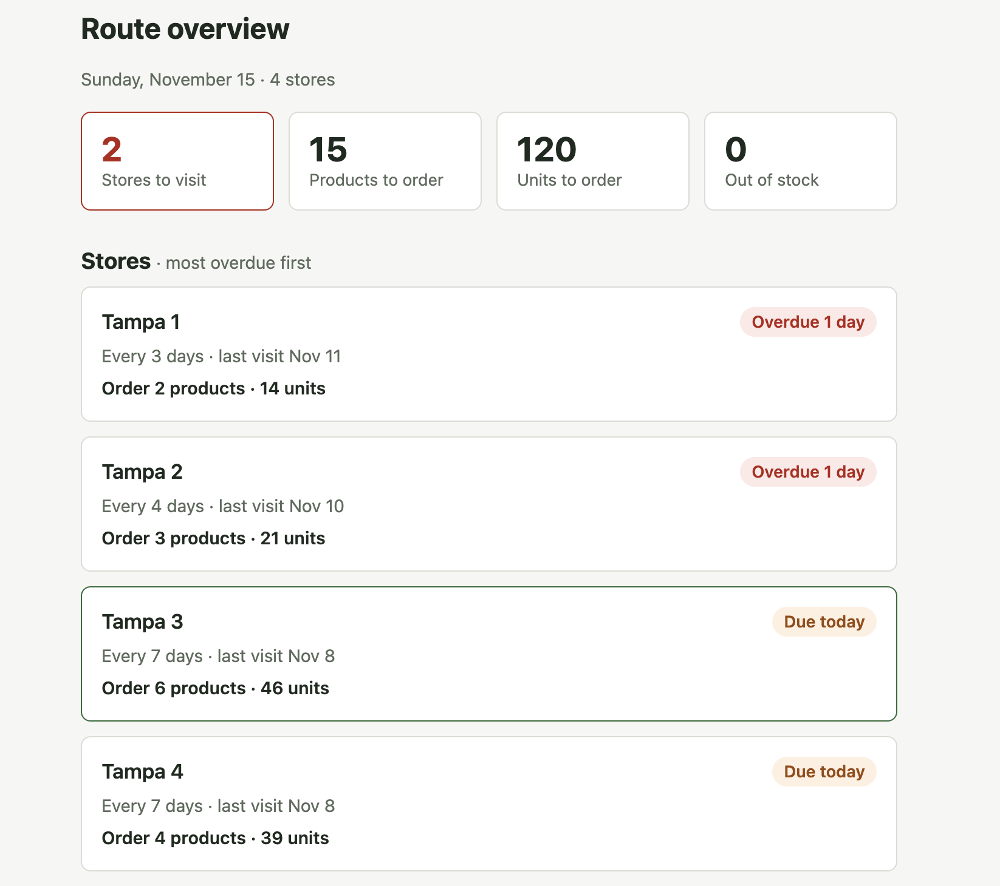

# Restock


**Live demo:** https://restock-xthx.onrender.com/
*(free hosting: the first load can take 30–60 seconds while the server wakes up)*

Restock is a phone-friendly tool for **field merchandisers**: the people who visit
retail stores, count what's on the shelf, and decide what to reorder. You log the
counts from each store visit, and Restock works out how fast each product is selling
and suggests how much to order so the shelf lasts until your next visit.

I built it from my own experience as a vendor merchandiser covering 8 big-box
garden centers, where I did all of this with paper and memory.



## What it does

- **Route overview**: every store sorted by how overdue its visit is, with totals
  across the route (stores to visit, products and units to order, items out of stock).
- **Store page**: an order list first, then the latest counts sorted by what needs
  ordering, then collapsible visit history.
- **Log a visit**: a form built for a phone (number keypad, big tap targets) that
  checks every entry and shows mistakes without saving anything.
- **JSON API** for stores, products, visit history and logging visits
  (interactive docs at [`/docs`](https://restock-xthx.onrender.com/docs)).

The demo data is invented: 4 stores (Tampa 1–4), 8 plants and 7 weeks of visits,
rebuilt every time the server starts so it always looks current.

## Reorder formula

```
units sold        = previous on-hand + units received - current on-hand
sell-through rate = units sold / days between the two visits
suggested order   = rate × days until next visit + safety buffer - current on-hand
```

The order is rounded up to whole units and never negative. No suggestion is made
(shown as "—") when there's no trustworthy history:

- **First visit**: nothing to compare against
- **Zero days between visits**: no rate can be computed
- **Negative sales** (a miscount): flagged for review instead of guessed

The logic is in [`reorder.py`](reorder.py) and tested in
[`tests/test_reorder.py`](tests/test_reorder.py).

## Data model

SQLite, with hand-written SQL in [`schema.sql`](schema.sql) and [`queries.py`](queries.py).

| Table      | Columns |
|------------|---------|
| `stores`   | `id`, `name`, `city`, `visit_frequency_days` |
| `products` | `id`, `name`, `size`, `category` (name + size is unique) |
| `visits`   | `id`, `store_id` → stores, `visit_date`, `notes` |
| `counts`   | `id`, `visit_id` → visits, `product_id` → products, `on_hand`, `received` (one row per product per visit) |

`CHECK` constraints keep counts from going negative, and foreign keys are enforced.

## How it's built

Python 3.14, FastAPI, SQLite (standard `sqlite3`, no ORM), Jinja2 templates with
plain CSS (no JavaScript framework, no build step), pytest, deployed on Render.

| File | Job |
|------|-----|
| `main.py` | Web routes: HTML pages and the JSON API |
| `overview.py` | Works out each store's order list, totals and due status in one place, so every page agrees |
| `reorder.py` | The reorder formula |
| `forms.py` | Checks the visit form's input |
| `queries.py` | All SQL |
| `db.py`, `schema.sql` | Database connection and tables |
| `seed.py` | Builds the invented demo data |
| `templates/`, `static/` | HTML pages and CSS |

## Run it locally

```bash
git clone https://github.com/carlosspedrazaa/restock.git
cd restock
python3 -m venv .venv
source .venv/bin/activate
pip install -r requirements.txt
python seed.py               # builds restock.db with demo data
uvicorn main:app --reload    # then open http://127.0.0.1:8000
```

Run the tests with `pytest`. They also run on every push via GitHub Actions.

## Evaluation

Coming soon: accuracy of the visit-notes parser on a hand-labeled set, and a
simulation comparing stockouts under the reorder formula against a fixed-order
baseline.

---
